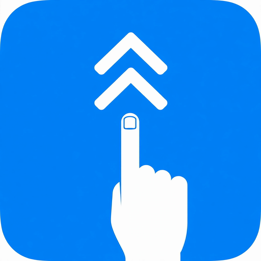

# Auto Scroll

**Scroll otomatis untuk TikTok, Instagram, dan aplikasi lain — tanpa capek jempol.**

Auto Scroll adalah aplikasi Android yang men-scroll layar secara otomatis dengan interval yang bisa diatur. Cocok buat nonton TikTok atau Instagram sambil santai.

## ✨ Fitur

- ▶️ Tombol melayang untuk mulai / berhenti scroll dari aplikasi apa pun
- ⏱️ Interval swipe bisa diatur (1–10 detik)
- 👆 Tahan tombol melayang untuk menyembunyikannya
- 🔋 Tetap jalan di background (dengan izin baterai)
- 🎨 Tampilan simpel dan segar

## 📥 Cara Install

1. Download APK terbaru di bawah ini, atau dari halaman [Releases](../../releases).
   - **v1.5 (terbaru):** [AutoScroll-Ink-v1.5-debug.apk](https://github.com/janssenpapa/auto-scroll/raw/main/releases/AutoScroll-Ink-v1.5-debug.apk)
2. Buka file APK-nya, izinkan **"Install unknown apps"** kalau diminta.
3. Buka aplikasi **Auto Scroll**.
4. Tekan **"Buka Pengaturan Aksesibilitas"**, lalu aktifkan layanan **Auto Scroll**.
   - Android akan menampilkan peringatan soal aksesibilitas — itu wajar. Aplikasi ini hanya mengirim gesture swipe, **tidak membaca isi layar**.
5. Atur interval swipe, lalu buka TikTok / Instagram dan tekan tombol ▶ yang melayang.

## ▶️ Cara Pakai

1. Buka TikTok, Instagram, atau aplikasi lain.
2. Tekan tombol ▶ yang melayang untuk mulai auto-scroll.
3. Tekan ⏸ untuk berhenti sementara.
4. Tahan tombol melayang agak lama untuk menyembunyikannya. Untuk menampilkan lagi, buka aplikasi lalu tekan **Mulai**.
5. Kunci aplikasi di Recents dan izinkan jalan di background supaya tidak dimatikan sistem.

## 💛 Donasi & Hapus Iklan

Aplikasi ini gratis dan menampilkan iklan banner di layar utama.

Donasi **Rp15.000** sekali via [Saweria](https://saweria.co/kusharyadi) untuk menghapus iklan **selamanya**. Setelah donasi, hubungi pembuat aplikasi untuk mendapatkan kode unlock, lalu masukkan kodenya di menu **Lainnya → Hapus Iklan**.

## 🔒 Privasi

Auto Scroll **tidak mengumpulkan, menyimpan, atau mengirim data pribadi apa pun**. Layanan aksesibilitas hanya digunakan untuk mengirim gesture swipe (scroll) atas perintah pengguna.

## 🙏 Kredit

Dibuat oleh **Kus** — https://saweria.co/kusharyadi

© 2026 Harris Kusharyadi
